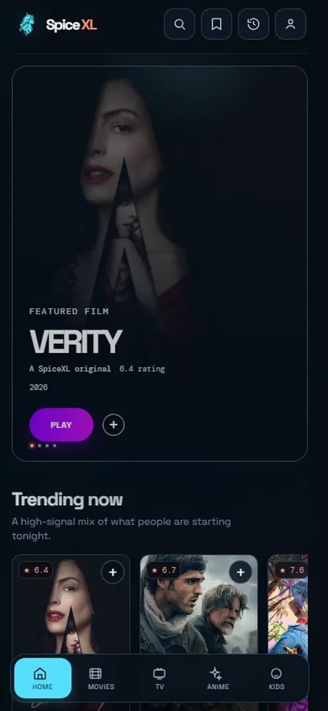
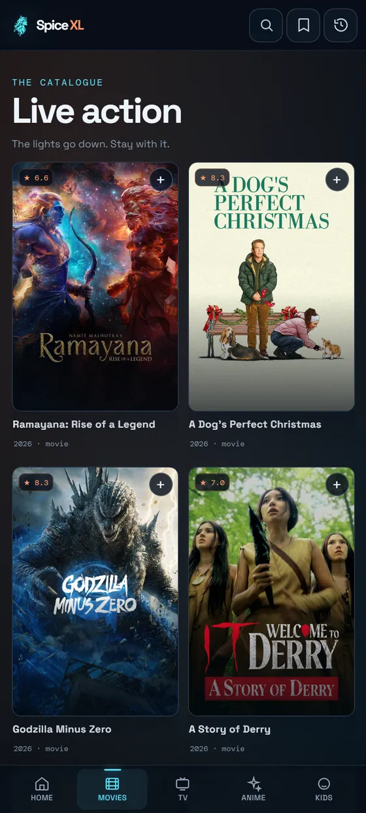
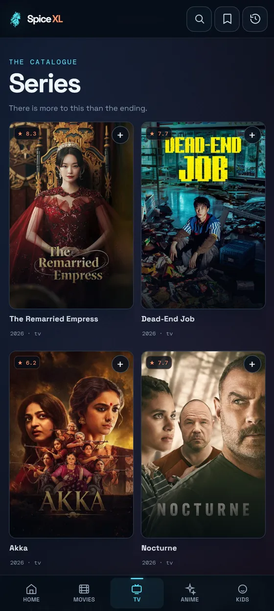
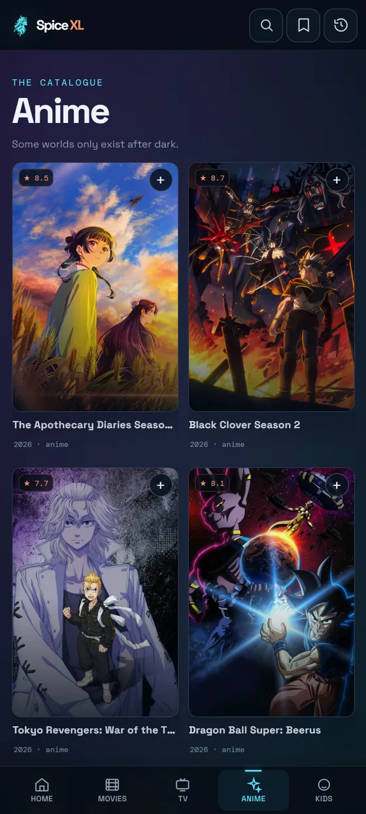
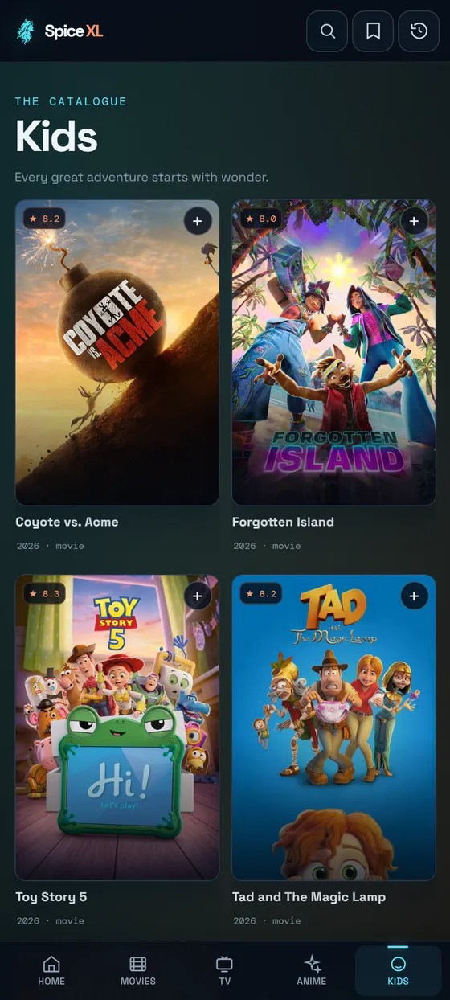
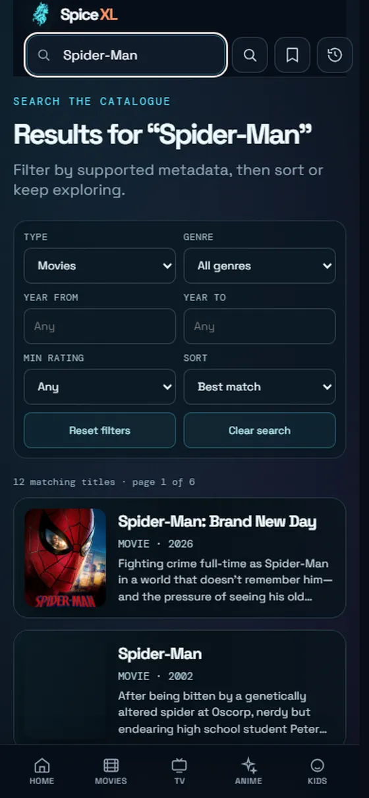
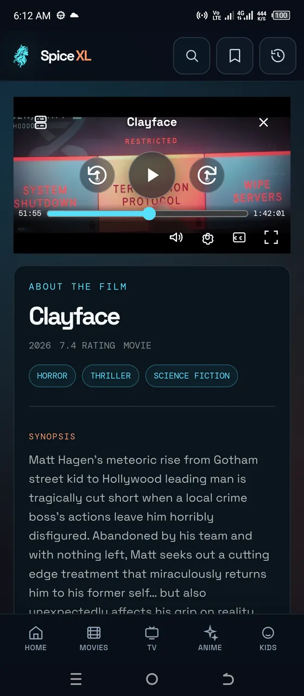

# SpiceXL

### A world of stories, in one place.

Discover movies, series, anime, and family picks in a dark, cinematic experience for Android and Windows.

[**Get SpiceXL 1.1.0**](https://github.com/codeplayboy/SpiceXL/releases/tag/v1.1.0) · [Windows setup guide](docs/INSTALLATION.md#windows) · [Android setup guide](docs/INSTALLATION.md#android) · [Playback status](docs/PLAYBACK_STATUS.md)

 

Real SpiceXL interface footage · 30-second launch cut excerpt

---

## A closer look

Browse the real app screens. Select any image to see it at full size.

| Home | Movies | Series |
|:---:|:---:|:---:|
|  |  |  |

| Anime | Kids | Search |
|:---:|:---:|:---:|
|  |  |  |

See the player screen

 

## What’s inside

- Five destinations: Home, Movies, TV, Anime, and Kids.
- Search, saved titles, and watch history.
- Title details and episode browsing for series.
- A built-in playback experience with available player controls.

Content and playback availability can vary by title, network, and region.

## 1.1.0 release status

This release documents the playback behavior clearly so a client-side fix is not confused with a provider-side data problem.

### Fixed in the app

- Automatic audio selection now prioritizes the title's original language when reliable language metadata is available.
- A generic provider or server name is no longer treated as proof of the language that will be heard.
- Once a media manifest is available, its actual audio-track metadata is authoritative.
- The player no longer reports ordinary internal buffering or recovery seeks as repeated user “Seeking…” actions.
- Manual seeking still receives the appropriate seeking state, while subtitle behavior and user-selected language preferences remain unchanged.
- Playback recovery remains bounded and avoids duplicate transitions during a real media failure.
- The compact Next Episode flow remains based on actual playback completion, with the pre-finish control shown during the configured notice window.

### Still provider-dependent

- A provider can incorrectly label a route. If that route does not expose reliable audio-track metadata, the client cannot prove its audible language without guessing.
- Available qualities, language variants, subtitles, and playback stability may differ by title, provider route, network, and region.
- A route that fails after a seek may trigger bounded recovery or a different available route; that does not create a missing quality or language variant on the backend.
- The client cannot manufacture a native-language 720p/1080p/4K variant that the provider did not publish.

For the full boundary between app fixes and provider limitations, see [Playback status](docs/PLAYBACK_STATUS.md). No private endpoints, raw media URLs, credentials, cookies, or tokens are published in this repository.

## Download

Choose the installer for your device from the [SpiceXL v1.1.0 release](https://github.com/codeplayboy/SpiceXL/releases/tag/v1.1.0):

- **[Download for Android](https://github.com/codeplayboy/SpiceXL/releases/download/v1.1.0/SpiceXL-Android-v1.1.0.apk)** — `SpiceXL-Android-v1.1.0.apk`
- **[Download for Windows 64-bit](https://github.com/codeplayboy/SpiceXL/releases/download/v1.1.0/SpiceXL-Windows-Setup-v1.1.0.exe)** — `SpiceXL-Windows-Setup-v1.1.0.exe` (if included in the release)

Follow the illustrated [installation guide](docs/INSTALLATION.md) for the first launch and removal steps.
You can verify either download against the published [SHA-256 checksums](docs/RELEASE_CHECKSUMS.txt).

## About the creator

SpiceXL is an independent project by [@codeplayboy](https://github.com/codeplayboy). This public release repository contains the installable builds and product materials; it does not publish private application source, credentials, or signing material.

## Release contents

The uploaded app downloads are installable release artifacts. Screenshots and the short motion preview are presentation materials; this repository does not include private application source, credentials, signing keys, provider internals, or raw playback URLs.
